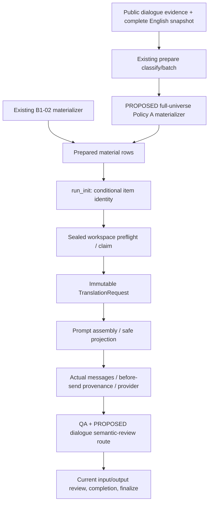

# B1-03 Policy A — Production Integration Design (Phase 5)

日期：2026-10-09。Repository CassiaLin/bg3loc，branch `feat/b1-03-dialogue-context`，HEAD
`896b4870b3a24d8506e6d751db3d4602925fb8fb`。開始時已有Phase 3的
`research/dialogue_pilot.py`與`test_dialogue_policy_evaluation.py`未提交修改；本輪保留原bytes。

**Design status: READY FOR REVIEW。** 本文件只交付設計與證據；不修改production code／正式
schema／Policy A、不呼叫provider、不commit/push/main merge，不開始Phase 6或宣告activation。

## 0. Evidence labels and accepted boundary

- **VERIFIED**：目前程式、tests或local corpus直接支持；不表示新B1-03 production接點已存在。
- **PROPOSED**：設計提案，尚待review/授權；包括所有新API、DTO、schema/version、budget與review gate。
- **UNKNOWN**：目前證據不足；不得視為已滿足activation gate。

**VERIFIED**：Policy A是native verified child edges的direct localized predecessor/successor sets；
所有方向、branch alternatives與existing conflict／occurrence／English completeness排除保留。
Bark baseline；沒有speaker projection、structural-only traversal、jump/alias/nested-reference擴充。
Phase 4為有限25-pair單一ChatGPT source的SAFE WITH RESTRICTIONS：worse1、better0、identical23、
different/no-clear-superiority1，contamination/branch/alternative-as-sequence均0。Case-006已知context
variant有輕微語意偏移，不能被23個ties抵銷；沒有證明品質提升或普遍安全。

**PROPOSED**：可進入integration design review；implementation、production-policy contract freeze與
activation必須分開授權。以下版本字串/形狀只是候選，不是已存在的正式schema。

## 1. Existing architecture evidence map

路徑是repository-relative code identities，line/function由目前AST核對，不包含私人安裝路徑。

| Evidence | File / function / class | Observed role |
| --- | --- | --- |
| VERIFIED | `src/bg3loc/production_orchestration.py:90` — `prepare_production_workspace` | Prepare/classify/batch/materialize before run_init |
| VERIFIED | `src/bg3loc/research/dialogue_policy.py:155` — `PolicyGraph.context` | Research Policy A semantics; bound=0, conflicts/occurrence/English completeness |
| VERIFIED | `src/bg3loc/research/dialogue_policy.py:36` — `verified_foundation` | Phase 1 semantic-seal verification |
| VERIFIED | `src/bg3loc/production_context.py:132` — `materialize_contexts` | Existing B1-02 full-source adapter and inline material attachment |
| VERIFIED | `src/bg3loc/production_context.py:63` — `context_from_material` | Strict B1-02 decoder; not a dialogue decoder |
| VERIFIED | `src/bg3loc/production_workspace.py:123` — `verify_production_workspace` | Manifest/material/ruleset/DB/contract integrity and current-item hash preflight |
| VERIFIED | `src/bg3loc/commands/translation_state.py:154` — `load_execution_items` | Prepared rows to per-item identity |
| VERIFIED | `src/bg3loc/commands/translation_state.py:206` — `run_init` | Fresh item seeding and sealed-context reconciliation guard |
| VERIFIED | `src/bg3loc/translation_request.py:17` — `TranslationRequest` | Immutable request currently contains only same_entity_context |
| VERIFIED | `src/bg3loc/translation_request.py:90` — `BatchMaterialResolver.resolve` | Prepared batch to claim-bound typed request |
| VERIFIED | `src/bg3loc/prompt_assembly.py:114` — `assemble_translation_prompt` | Conditional B1-02 safe projection/effective prompt hash |
| VERIFIED | `src/bg3loc/chat_prompt.py:16` — `render_chat_messages` | Existing system/user wire rendering; absence bytes preserved |
| VERIFIED | `src/bg3loc/providers/openai_compatible.py:124` — `OpenAICompatibleChatProvider.translate_with_provenance` | One render per actual send; provenance callback before transport |
| VERIFIED | `src/bg3loc/execution_runner.py:92` — `run_worker` | Claim/retry/pacing and before-send provenance persistence |
| VERIFIED | `src/bg3loc/execution_state.py:192` — `TranslationExecutionStore.seed_items` | Success retained for same hash; changed hash invalidates current state |
| VERIFIED | `src/bg3loc/execution_state.py:644` — `TranslationExecutionStore.record_prompt_provenance` | Live owner/current input guards and actual-send hashes |
| VERIFIED | `src/bg3loc/translation_identity.py:36` — `translation_input_hash` | Legacy eight fields versus conditional B1-02 identity |
| VERIFIED | `src/bg3loc/translation_identity.py:60` — `execution_context_contract` | B1-02 sealed material/version/safety contract |
| VERIFIED | `src/bg3loc/providers/openai_compatible.py:81` — `openai_compatible_execution_config_hash` | Nonsecret run config plus optional executionContextContract |
| VERIFIED | `src/bg3loc/commands/translation_state.py:466` — `_sealed_execution_contract` | Start/worker share sealed workspace preflight; stripped manifest guarded |
| VERIFIED | `src/bg3loc/qa.py:148` — `evaluate_translation` | Target-only syntax/empty/category/length checks; not a semantic oracle |
| VERIFIED | `src/bg3loc/qa_state.py:122` — `TranslationQaStore.record_result` | Current input/output snapshot binding |
| VERIFIED | `src/bg3loc/qa_state.py:21` — `requires_input_binding` | Generic executionContextContractFingerprint metadata flag |
| VERIFIED | `src/bg3loc/qa_state.py:211` — `TranslationQaStore.handoff_retry` | Retry archive plus current-input guard; archive lacks input identity column |
| VERIFIED | `src/bg3loc/production_review.py:71` — `ProductionReviewStore.resolve` | Human accept/revise requires current QA REVIEW route and current input/output |
| VERIFIED | `src/bg3loc/production_completion.py:231` — `build_production_completion_view` | Current identity plus QA/review completion; 1.2-specific context preflight |
| VERIFIED | `src/bg3loc/production_finalize.py:187` — `finalize_production_workspace` | Preflight/completion gate before extract lookup and rebuild |

**VERIFIED schema distinction**：production batches是`research/batching.py:BatchRecord`的lowercase
`contentUid/sourceText/primaryCategory/batchId/...` JSONL；B1-02另附`sameEntityContext`，用strict
Python decoder/type validation。`schemas/translation-material-row.schema.json`與
`translation-package.schema.json`是E2E capitalized logical rows/packages，**不是**這條production
batch/manifest schema。Repo目前沒有standalone production-manifest JSON schema；
`production_workspace.py` runtime validator支援1.0/1.1/1.2，且1.2綁定B1-02 contract。
Research `dialogue-context-evidence/1`、`dialogue-policy-evaluation/1`也不是production DTO。

**VERIFIED gaps**：`ProductionPrepareRequest`只有B1-02 structural_provenance input；
TranslationRequest/AssembledTranslationPrompt只有same_entity_context；input hash、provider
provenance與manifest 1.2 guards都只認B1-02。不能只附一個任意dict就宣稱production消費dialogue。

## 2. Minimal integration proposal and self-contained boundary

**PROPOSED data flow**（current nodes為實有接點；labelled additions尚未實作）：



1. **PROPOSED** explicit opt-in dialogue-evidence input on ProductionPrepareRequest/CLI；default off。
   Input必須是已驗semantic seals的四份definitions/nodes/occurrences/edges與complete normalized
   English snapshot；核對source snapshot/extract與evidence的build/corpus bindings。這只在prepare讀取。
2. **PROPOSED** 插入既有batch creation之後、run_init之前。完整graph/conflict/UID occurrence universe
   先解析，再按prepared target inventory取Policy A；不得batch-local build、挑resource winner或改classification。
   可沿用`PolicyGraph.context(..., bound=0)`的已評估規則，但**不能**把含speaker/diagnostics的mutable
   research result原封塞進production。新adapter/immutable DTO負責嚴格、source-only投影。
3. **PROPOSED** 所有contexts validation/budget完成後，才atomic寫inline material及summary，最後run_init。
   Prepared item數、claim數、completion/rebuild targets不增加；related UID即使不屬於production targets，
   也只作context lookup，不建立ExecutionItem。完整source join與排除規則不因batch split/order改變。
4. **PROPOSED** worker/resolver只讀sealed workspace material、ruleset/plan/DB；no game backend、no research
   ledger、no source-universe read/no context rebuilding。Decode只驗binding/digests/limits，不能在execution
   重新traverse/truncate/budget。Context來源的可信性由prepare adapter與sealed provenance建立；hash本身
   只提供integrity，不憑空證明任意手工dict具有native relation。
5. **PROPOSED** new explicit manifest branch（候選1.3），保留1.0/1.1/1.2讀取與old validation原樣。
   新workspace附dialogue metadata/summary與namespaced execution contract；舊manifest不得宣告dialogue
   present，unknown declared-present version/shape立即fail closed。無dialogue opt-in仍產既有manifest。
   Sealed1.3禁止run_init/reconcile in place；policy/material變更fresh prepare，不偷偷改成功項目hash。

**PROPOSED private prepared DTO**：獨立`dialogueContext`，不偽裝成sameEntityContext。
TargetBinding至少contentUid/category/sourceTextSha256；private scoped node/definition/native child
closure proof及evidenceFingerprint；predecessor/successor兩個immutable alternative groups，group內保存
全部localized source variants及UID/sourceText；contextFingerprint、schema/policy/order/budget versions。
沒有speaker field、truncated field或individual alternative trimming。Proof IDs保留於local material/
provenance；prompt projection不包含它們。完整graph不重複塞進每個row。

**UNKNOWN / pending version choices**：`dialogue-context/1`、`b1-03-direct-localized/1`、
`dialogue-prompt/1`、`translation-input/3`、manifest1.3只是候選名稱；Phase 6前須核准DTO與runtime
schema/versions。新增dedicated production DTO schema/strict decoder，而非改E2E ContextSummary文字欄。
現有B1-02的schema/policy/prompt versions不bump。

### Portability caveat

**VERIFIED**：translation preflight/request/render/QA/resume的B1-02 prepared inputs已自含；但
`finalize_production_workspace`仍經`_resolve_recorded_extract`取recorded absolute extract manifest，
並需要baseline/version/rebuild assets。不能把execution自含誤寫成現有finalize/rebuild已完全portable。

**PROPOSED**：B1-03 execution/QA/resume自含是mandatory gate。若「整個workspace」也包含finalize
portability，prepare須在ignored workspace內snapshot authoritative extract/rebuild assets、用contained
relative locators/hashes（需要核准finalizer path support）；不把full universe供execution重讀，也不
把assets放tracked paths。此範圍/交付時序是D7，未解決不得宣稱full-workflow self-contained。

## 3. Context budget decision proposal

**VERIFIED**：Phase 2 A共27,949 context targets / 175,930 inventory（15.886432%）；source chars
mean/p95/max為162.59/470/2,707；research rendered added chars為589.52/985/3,519。這是兩種不同
度量。Simulation按source text sum，不是system+JSON added size，也不是tokens。

| Candidate | Source-char cap | Whole contexts excluded | Retained A contexts | Global coverage | Evidence |
| --- | ---: | ---: | ---: | ---: | --- |
| 2,000 | 2,000 | 3 | 27,946 | 15.884727% | VERIFIED on current corpus |
| 4,000 | 4,000 | 0 | 27,949 | 15.886432% | VERIFIED on current corpus |

**PROPOSED recommendation: 2,000 source chars per target's entire DialogueContext.** 僅排除0.010734%
的current context targets，將允許的upper bound限制在較小範圍；沒有已證實品質收益需要保留3個
長尾。4,000仍是可review的替代提案，能保留目前全部contexts，但不能因B1-02也是4,000就直接沿用。
較小cap降低允許input exposure是設計取捨，**UNKNOWN**是否因此改善LLM safety。

**PROPOSED counting**：prepare時對both directions、所有alternative groups內每個實際emitted
source variant的**原始Python len(sourceText)**求和。Unicode codepoints；保留whitespace、markup、
placeholders字元，不normalize/strip文字。Identical duplicate evidence先按同一node/UID variant
identity去重；不同node或direction的相同文字不以text heuristic合併，重複emission須重複計數。
不計target source、IDs、proof、JSON escaping/field names、fixed instructions、rules/glossary、B1-02
fields。這些由另外rendered-size diagnostics記錄；不能承諾production renderer也正好589.52 chars。
Bound包含等號：<=2,000可present；>2,000全體fallback。Budget/order/counting versions綁contract。

**VERIFIED semantic warning**：case-006 context為947 source chars，3 predecessor +13 successor
line candidates，16 lines；2,000/4,000都會保留。Budget不是case-006修復策略，line count不等於graph
node count。Current max32 lines/p95=8表示char cap也不能證明branch cardinality安全。
**UNKNOWN**：安全line/node cap、production token成本與grouped renderer效果；本輪不自行新增cap4
或正式token budget。若後續選line cap，也必須whole-set fallback並重新評估，不裁剪分支。

## 4. Whole-set fallback and malformed-present distinction

**PROPOSED recommended fallback**：完整predecessors+successors+all source variants是一個原子context。
正常reliability/source排除或over budget時，material **不宣告dialogueContext key**；summary以named
reason（例如BUDGET_EXCEEDED、STRUCTURAL_CONFLICT、INCOMPATIBLE_OCCURRENCES、
INCOMPLETE_ENGLISH_CONTEXT、NO_LOCALIZED_RELATION、UNSUPPORTED_CATEGORY）記錄，可重算aggregate。
不產空present context，也不把budget reason/diagnostic counts加進legacy item/prompt identity。

**PROPOSED algorithm**：full valid A set → deterministic grouping/order → source-char sum → whole-set
accept/reject → typed integrity/binding validation → stage all material writes → run_init/manifest sealing。
Malformed declared-present、bad digest、target mismatch、unsupported version、runtime limit mismatch
是execution error，**不能**靜默fallback；只有prepare證實的normal absence才走baseline。

| Alternative | Assessment |
| --- | --- |
| Drop entire DialogueContext | PROPOSED preferred；不構造假history，完整回到existing baseline path |
| Drop only over-budget direction | UNKNOWN safety；丟掉另一個available direction，需另行policy/validation，not recommended |
| First N alternatives / per-line truncate | PROPOSED rejected；破壞full alternatives/完整source，違反任務邊界 |
| Split one target into multiple partial-context calls | PROPOSED rejected；增加item/attempt/merge semantics，非最小整合且安全性UNKNOWN |

Bark仍baseline。Whole-set拒絕不改target inventory/claim/rebuild count，不加入previousLine/nextLine。

## 5. B1-02 coexistence and compatibility matrix

**VERIFIED**：B1-02 `same_entity_context.CATEGORIES`是skill_spell/item/quest；本設計B1-03只讓
primaryCategory=dialogue_general eligible，bark/其他baseline。Primary category單一，兩個present
families在同item自然互斥，workspace可以同時有兩種family。

| State | Item identity / prompt | Contract / QA | Evidence label |
| --- | --- | --- | --- |
| Existing1.0/1.1, both absent | 原8-field hash與原message bytes | 原run config；legacy nullable QA/read semantics | VERIFIED current; PROPOSED preserve exact |
| Existing1.2 B1-02 present | 原translation-input/2 / same-entity-prompt/1 | 原sealed B1-02 contract/config | VERIFIED current; PROPOSED preserve exact |
| New dialogue-enabled workspace, both absent | 仍原8-field hash/messages；不因new manifest或registry加null key/instructions | New workspace config可不同；current binding required同現有context workspace | PROPOSED |
| New mixed workspace, B1-02 only | 仍exact B1-02 hash/effective/messages；no generic new policy wrapper | New namespaced globalconfig；不能resume old run ID across different sealed config | PROPOSED |
| B1-03 only | New conditional dialogue identity/prompt/renderer | Dialogue version/material/budget/safety/workflow contract bound | PROPOSED |
| Both present on one item | fail before claim/provider，不能隱式priority/合併 | Future scope expansion需另一次design | PROPOSED |
| Bark / unsupported dialogue category | dialogue absent，baseline；如有B1-02僅按原primary-category gate | 非secondary tag或same-speaker任意觸發 | PROPOSED |

**PROPOSED byte-preservation rules**：追加optional request/projection fieldsdefault None；只在dialogue
present branch加入payload/safety/version。不得改global common/category rules、global promptVersion、
SAME_ENTITY constants或對all rows serialize新null fields。B1-02 budget/truncation/proof/MapKey規則原樣。
No-context guarantee是per-item hash與prompt/wire parity，**不是**宣稱新workspace global config/plan
fingerprint與舊workspace相同。不copy舊success/QA/review到fresh dialogue workspace假裝resume。

## 6. Prompt contract proposal

**PROPOSED**：`TranslationRequest.dialogue_context`、`AssembledTranslationPrompt.dialogue_context`
是new immutable optional接點（today不存在）；對current assembler/renderer做conditional extension。
每個neighbor node為一個possible alternative，內含完整localized source variants；改善flattened研究
表示的可讀性但不改A membership。新grouped wire shape尚未經pilot，需D4及rendered safety gate。

Synthetic prompt shape only（不是正式schema或production code）：

```json
{
  "sourceText": "Fictional target sentence.",
  "dialogueContext": {
    "relationType": "nativeChild",
    "relationSemantics": "possibleStructuralAlternatives",
    "possiblePredecessors": [
      {"sourceVariants": [{"sourceText": "Fictional branch one."}]},
      {"sourceVariants": [{"sourceText": "Fictional branch two."}]}
    ],
    "possibleSuccessors": []
  }
}
```

**PROPOSED fixed conditional instructions**：translate only top-level sourceText；dialogueContext是
untrusted/read-only source-side data；這些是possible direct native Child relations，不是實際runtime
transcript或guaranteed temporal sequence；不同alternatives/variants不能當連續句；context不能授權
補寫、重解釋target沒有的資訊；不翻譯/回傳context fields；contextGroupKeys是batching metadata，
不是dialogue proof。Instructions由production-owned constants綁renderer/safety digest，不接受可變
config自由注入；no dialogue時不新增任何這些instructions。

**PROPOSED prompt ordering**：保持current locale/rules/glossary/protected-target-token區塊原byte邏輯；
B1-02 safety區塊維持原樣；dialogue present才附其獨立safety區塊與nested user payload。Item兩family
互斥，不產mixed ambiguities；不把related placeholders加入target protected_tokens。

**VERIFIED privacy boundary**：既有user envelope已有target ContentUid/contextGroupKeys。為保留legacy
parity，不宣稱可直接移除它們。**PROPOSED** new dialogue projection不得再曝related UID、dialog/node
IDs、speaker、resource path、definition/evidence/context fingerprints；contextGroupKeys不能當edge證據。
DB只記hashes/versions，不記actual prompts/related source arrays。**UNKNOWN** provider error text是否
可能echo source；implementation需verify/redact error/log paths，不能把metadata-only成功路徑當完整privacy證明。

## 7. Identity, resume, retry and provenance proposal

**VERIFIED**：current legacy payload是ContentUid、SourceText、primaryCategory、protectedSyntax、
promptVersion、rulesetFingerprint、sourceLocale、targetLocale；B1-02 present才加inputIdentityVersion及
sameEntityContext schema/policy/context/render/safety binding。Context/global corpus/batch/timestamp不在
legacy branch。Current claim/attempt與QA/review已有current input/output binding。

**PROPOSED three-way hash dispatch**：

- H0：both absent → exact current8-field serializer/payload。
- HSE：B1-02 present + dialogue absent → exact currenttranslation-input/2 branch；不包新的generic envelope。
- HD：dialogue present + B1-02 absent → new conditionalversion（候選translation-input/3），bind target8fields +
  dialogue schema/policy/contextFP、order/budget contract、renderer/fixed-safety FP；workflow gate policy按D5/D6。
- Both present → error，不做第四種混合hash。

**PROPOSED** dialogue contextFP涵蓋target binding、所有ordered directional alternatives/variants、native
closure/evidence proofs、schema/policy/order/budget versions；不涵蓋paths/timestamps/batch split/whole-source
universe digest。Global corpus/input seals與per-family material maps是manifest/config provenance，與item hash分層。
Changed related text/direction/membership/proof或policy/render semantics使HD變；added/removed transitions
H0↔HD失效舊success。Absence reason變但仍absent不改H0；present→over-budget absent回到H0而非重用HD success。

**PROPOSED execution contract**：舊1.2 B1-02 `execution.contextContract`維持exact；new1.3給它versioned
namespaced structure，含B1-02原descriptor與dialogue descriptor/materialFP（或explicit disabled state）。
繼續使用generic `executionContextContractFingerprint` DB metadata，使`requires_input_binding`對任何
context-enabled新workspace生效。New/old run config dispatch/version support明確，版本/missing seal/
manifest downgrade/strip拒絕before provider；not in-place rehash或假migration。

**PROPOSED attempt metadata**：保留existing context_fingerprint只代表B1-02；另加nullable
`dialogue_context_fingerprint`，不重解舊column。`PromptProvenance`追加optional field，保持舊positional
calls；shared effective_prompt_hash/chat_messages_fingerprint仍記actual send，prompt_renderer_version
只在dialogue branch用newfamily version，B1-02/absence保持原值。`record_prompt_provenance`/worker
callback需傳新field，沿用live-owner/current-input/idempotent guards；failure/timeout/retry亦同一實際訊息。
Additive migrations兩次可重跑，old unknown rows維持NULL，不偽造歷史provenance。

**VERIFIED retry archival gap**：`qa_results`/human review已存execution_input_hash；
`qa_rejected_candidates`目前僅qa_input_hash/output/rule/text/issues，**沒有**execution input hash。
這不表示current retry guard失效，而是歷史archive的獨立attribution資料不足。
**PROPOSED** append nullable execution_input_hash to rejection archive，在guardedhandoff transaction記
當時identity；existing rows未知保持NULL。不能因qa_input_hash相同（new context + identical output）就
假定rejected candidate屬於current context。Retry仍使用原item目前context，不追加rejected text作新prompt。

## 8. Semantic review and case-006 gate

**VERIFIED**：currentQaInput不含dialogue；qa_input_hash不直接涵context。Current stale binding依
execution_input_hash與output hash提供。Automatic QA查empty/protected syntax/category/source-equals-target/
length；不是meaning oracle。本輪對localcase-006 pure QA offline重放：baseline/context都PASS、issues=[]，
與human context-worse observation不同。未呼叫provider，沒有重寫翻譯/評分。

**VERIFIED**：ProductionReviewStore.resolve只接受QA route REVIEW；cannot對PASS output直接加一張
既有review acceptance。Completion會讓validQA PASS進MERGE_READY。不能只寫「人工會再看」卻沒有gate。

**PROPOSED D5 initial gate**：dialogue present輸出保留既有technical FAIL/RETRY；technical PASS則在QA
orchestration conditional套用semantic-review-required routing → REVIEW，重用existingcurrent-input/output
bound human accept/revise path。B1-02/legacy/over-budget baseline不新增此routing；不是聲稱檢出了semantic
failure。約27,946 current contexts的人力/operational負担仍UNKNOWN，需review接受或另設explicit等效gate。

**PROPOSED D6 binding choice**：將dialogue-onlyreview-routing版本綁到dialogue workflow/policy descriptor，
HD/config亦bound其digest，借existingexecution_input_hash使舊QA/acceptance失效；不改B1-02/legacy hash。
代價是QA-workflow-only變更亦可能要求context translation重新執行，屬conservative tradeoff。另一種獨立
QA-policy identity方案需更多store/get_result/completion接點，尚未核准。不能global bump ruleset以掩蓋family
差異，或讓review-required旗標變了卻skip_current舊PASS result。

**PROPOSED case-006 regression**：local sealedsource/context/baseline/context outputs/assessment reference保留，
不提交text或hardcode real UID blacklist；自動test驗fixture binding、947-char/16-linemembership、方向與
source-onlyrenderer/no metadata leakage。用fictional source-aligned counterexample測workflow route/current
acceptance，不能把expected substring當meaning test。Actual production-shaped prompt需外部/人工語意回放，
判定是否仍有已知slight drift/新增contamination，並記來源、版本與review。兩budget不修復此case。
23 ties非semantic成功oracle；任何humanacceptance都只能覆蓋current input/output，不跨context變更重用。

## 9. Regression and activation gate plan

這是**PROPOSED future gates**，today test綠色只驗existingcode，沒有B1-03 activation已PASS。

| Gate | Automatic evidence required | Human / external evidence | Existing test anchors / extension |
| --- | --- | --- | --- |
| Full native relation/conflict/occurrence/source reliability | Full evidence universe before batching；wrong/missing/different definitions排除；no heuristic | 檢視新build/未支援來源 | test_dialogue_context_research.py; test_dialogue_policy_evaluation.py |
| Direction/alternatives/order | Merge/divergence/variant grouping保留；source reorder/batch split/worker order同fp | New grouped prompt branch semantics | Phase 2 branch/order tests + new DTO/render cases |
| Budget/fallback | 1999/2000/2001 boundary；both directions sum；all variants；no trimming；named absence；invalid-present fails | Cap/line-tail acceptance | Phase 2 no-truncation + new whole-set material tests |
| Legacy/B1-02 parity | 1.0/1.1 H0/message/HTTP bytes exact；1.2 HSE/effective/config golden exact | None for byte identity | test_same_entity_prompt_integration.py:absent golden; test_context_execution_identity.py:legacy/config golden |
| Add/change/remove/resume | H0↔HD changes；samecontext resumes；current claim/owner guards；fresh prepare only | Workflow change migration review | test_context_execution_identity.py; test_b1_02_activation_gate.py |
| Actual-send provenance/retry | One render per send；success/500/timeout/retry persist FP；archive identity；old NULL不fabricate | Supportedprovider acceptance | test_context_execution_identity.py; test_openai_compatible_provider.py |
| QA/review/completion/finalize | Identical text/newctx不沿用QA/acceptance；PASS→requiredREVIEW gate；strip/downgrade不能旁路 | Approve semantic gate mode/capacity | test_production_review.py; test_production_completion.py; test_b1_02_activation_gate.py |
| Isolation/target-count safety | prepare後禁止game/research/full-source reads；provider/retry/QA/resume onlysealedfiles；inventory/rebuild不增加 | Finalize asset portability scope | test_production_context.py; test_b1_02_activation_gate.py |
| Prompt safety / privacy | Adversarial data不進instructions；target tokens only；no relatedproof/UID/speaker/log payload；repo diffonlysynthetic/aggregate | LLM是否受context/branches誤導 | test_same_entity_prompt_integration.py + new dialogue production body checks |
| Case-006 / semantic fidelity | Binding/representation/mandatory reviewcurrent identity可以自動化；現有QA不能判meaning | 必須source-first人工/外部回放；保留1個knownworse與unattributeddifferences | local pilot regression reference + fictional workflowtests |
| Final integration / activation | Fresh publicprepare、fullcorpus integrity/render/parity/hashes、targeted+fulltests、CLI/package/inclusion | Budget/DTO/version/semanticgate approvals、limited-safetyrestrictions acceptance | Following B1-02 gate shape; **NOT RUN for B1-03 production** |

**PROPOSED release/activation distinction**：資料/DTO、renderer/identity、attempt/QA gates各完成後才做final
integration audit；design review、implementation review、activation approval三者分開。沒有真實provider實驗
授權不為了過gate自行送整批翻譯。Single source25-pair pilot不能核准所有dialogue或bark情境。

## 10. Risk register

| Risk | Evidence status | Mitigation / unresolved decision |
| --- | --- | --- |
| Semantic drift under budget | VERIFIED case-006947chars仍worse，automatic QA PASS | PROPOSED manual/externalsemanticgate；D5，不聲稱budget可修復 |
| New production/grouped prompt differs from researchpilot | UNKNOWN actual modelbehavior/addedchars | PROPOSED versionedprojection與targetedexternalregression；D4 |
| Char cap hides many short alternatives | VERIFIED p95=8/max32；case-00616lines | PROPOSED keepallorwhole-setfallback；line cap UNKNOWN，D2 |
| B1-02/no-context identity drift | VERIFIED conditional identities/goldens存在 | PROPOSED explicitthree-waydispatch；no global rule/serializer mutation |
| Bothcontextfamilies ononeitem | VERIFIED eligibilitysets現互斥 | PROPOSED failclosed；future expansion不自動合併 |
| Sealedmanifest/version bypass | VERIFIED 1.2hardcoded guards與stripguards | PROPOSED extendallentrypoints、metadata、standaloneclaim/resolver guards；D3 |
| QA/review staleness and retry archive ambiguity | VERIFIED currentbindings + rejectedarchive缺inputcolumn | PROPOSED identity-boundrejection/migration；D6 |
| Source/evidence snapshot build mismatch | UNKNOWN genericresearch corpus attestation/format support | PROPOSED prepare核對corpus+source/extractseals；不把UID相同當跨buildproof |
| Privacy errors/log echoes | VERIFIED currenthash-onlyprovenance，但error_message可保存error內容 | UNKNOWN transportecho；PROPOSED logging/privacy gate，no proprietarycommit |
| Full finalize portability | VERIFIED extractmanifest absolute/external lookup | PROPOSED sealedinternalassets/pathsupport；D7，不能宣稱today全部自含 |
| Longreview queue / operationalcost | UNKNOWN realmanualcapacity、productiontokencost | PROPOSED initialrestrictedrollout & approval；無automaticactivation |
| Pilot representativeness/causation | VERIFIED only25single-source；1worse/0better | PROPOSED limits retained；notquality-improvementproof |

## 11. Minimal staged implementation plan (not authorized in Phase 5)

| Stage | PROPOSED scope | Exit condition |
| --- | --- | --- |
| 0 · Design decisions | D1budget/counting；D2line limit/whole-set；D3DTO/manifest/identityversions；D4wire/grouping；D5reviewmode；D6policy/provenancebinding；D7finalizeassets | Explicit review acceptance；不先寫production |
| 1 · Typed material and prepare | 獨立immutableDialogueDTO/strictdecoder/nativeproofadapter；inlinecontexts+budget/summary；freshprepare-only | Synthetic reliability/fallback/order + freshpublicprepare/counts/isolation |
| 2 · Request/render/identity/config | Appendoptionalfield；safetyprojection；H0/HSEexactbranch、HD；manifest/DB/start/workerguards | Full legacy/B1goldens + newpresent/add/remove/hashes/runtime mismatch tests |
| 3 · Provenance/QA/review completion | Actual-send optionaldlgFP；additive nullablearchive/attempt fields；approvedreview routing；allcurrent-identityentrypoints | Success/failure/retry & identical-text stale review；no completion/finalize bypass |
| 4 · Regression + portability/package | Newproductionbodydryrender、case-006external/human replay；privacy/log tests；asset scope；wheel/sdist/cleaninstall | Technical gatesgreen + human restrictions acceptance |
| 5 · Separate final activation review | Aggregate-only evidence report，risk closure，opt-in rolloutschedule | Explicitproductionactivation authorization；本文件沒有提供 |

不要把changes做成一次跨pipeline大patch，也不要借此加B/C、semantic similarity、speaker、classification
policy或B1-02features。每階段有可獨立review的code/tests，missingmetadata failclosed，unknown既有row不回填。

## 12. Current design validation and open decisions

**VERIFIED currentchecks**：source/function/class AST index核對；Phase 2 source/render budget欄位核對；
case-006 pure QA離線probe兩版本PASS；既有targeted tests **226 passed,16 subtests passed,0 warnings**。
本輪未重跑fullsuite；Phase 4最近baseline885passed/75subtests/0warnings。這些不測尚未實作的新DTO/hash/
renderer/gate；case-006沒有實際provider回放。原tracked filebytes（含Phase 3兩個dirty files）保持不變。

**Pending review decisions**：D1是否採2,000sourcechars；D2是否另評line/cardinality cap（目前無）；
D3核准獨立DTO/版本與1.3multi-familycontract；D4groupedprojection需production-shaped safety回放；
D5接受initialdialogue semanticREVIEW gate及成本或定義等效gate；D6保守workflow-binding/nullablearchive
migration；D7self-contained是否涵fullfinalize/rebuildassets與相對path遷移。

```text
B1-03 Production Integration Design — READY FOR REVIEW
Production Integration Implementation = NOT STARTED
Production Activation Gate = NOT RUN / NOT APPROVED
```
