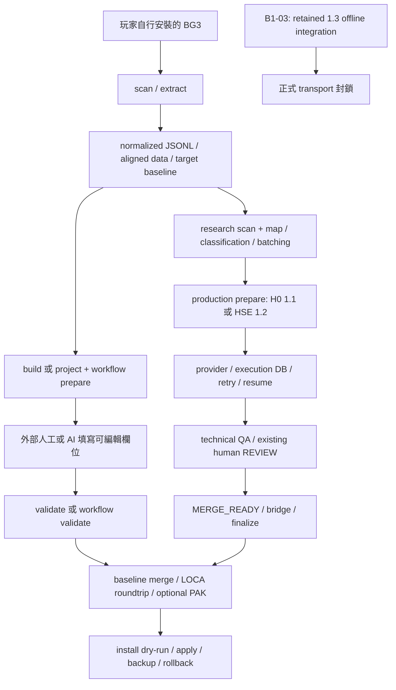

# BG3Loc Mainline Readiness Audit — 公開工具鏈盤點

日期：2026-10-10。Repository：`CassiaLin/bg3loc`。
本機 branch：`feat/b1-03-dialogue-context`。
HEAD：`896b4870b3a24d8506e6d751db3d4602925fb8fb`，未變更。

## 1. 審查結論與範圍

**主線已有從玩家安裝檔案到可重建語言檔的完整程式鏈路，並非只能消費既有研究工作區。** 最小路徑是 Windows、現有語言、`basic/standard`、外部人工或 AI 填寫素材，再由工具驗證、重建及備份套用。另有 H0／B1-02 的 resumable provider production 流程。

**尚不建議宣告一般公開 stable release 已全面就緒。** 本次直接執行程式與負向 probes，發現 locale 大小寫造成成功但空白的翻譯素材、provider fault message 可持久化回傳的 secret，以及 CI／sdist 測試覆蓋缺口。這些與 B1-03 是否啟用不同；不能用 Dialogue OFF 或先前 PASS 消除它們。

B1-03 已是 **explicit opt-in、預設 OFF、production transport BLOCKED**，不需要本階段修改 default 或 CLI。既有實作與 frozen contracts 全部保留。本報告不核准 B1-03 activation，也不執行任何修正。

證據來自本機現有原始碼、CLI parser、252 項 fresh targeted tests、native LSLib synthetic CLI 鏈路、重新建置的 wheel/sdist 與負向 probes。沒有以舊報告的 PASS 取代本次查核。未查證遠端 GitHub／PyPI 的發布狀態；結論適用於此 dirty checkout，不是某個已發布 tag。

標記：**VERIFIED**＝程式／本次執行直接支持；**PROPOSED**＝建議範圍或後續工作；**UNKNOWN**＝尚無足夠驗證。完成度另外區分「已實作且驗證」、「已實作但未正式整合／啟用」、「研究／設計」、「未實作」。

## 2. 現有架構與程式進入點



| 實際位置與 function/class | 責任與驗證範圍 |
| --- | --- |
| [cli.py](D:/workspace/codex/BG3/bg3loc-b1-02-real-corpus/src/bg3loc/cli.py:12), `build_parser`／`main` | 註冊 scan、extract、build、validate、rebuild、install、project、workflow、research、translation-state、qa、production；不是只有 research CLI |
| [scanner.py](D:/workspace/codex/BG3/bg3loc-b1-02-real-corpus/src/bg3loc/scanner.py:245), `build_manifest`／`discover_game`／`inspect_loca_entries` | 自動找 Steam 或接受明確 game-dir；找 Data/localization PAK、canonical locale、package SHA、Steam build ID；ambiguous providers 不視為 ready |
| [extractor.py](D:/workspace/codex/BG3/bg3loc-b1-02-real-corpus/src/bg3loc/extractor.py:32), `run_extract`／`normalize_loca_xml`／`verify_semantic_roundtrip` | canonical LOCA → XML → normalized UID/text/version；來源／目標／references 外聯集；LOCA roundtrip |
| [builder.py](D:/workspace/codex/BG3/bg3loc-b1-02-real-corpus/src/bg3loc/builder.py:42), `run_build`／`field_contract` | XLSX／CSV／JSONL、分批、immutable sidecars；直接低階素材流程不要求 research mappings |
| [validator.py](D:/workspace/codex/BG3/bg3loc-b1-02-real-corpus/src/bg3loc/validator.py:62), `run_validate`／`validate_immutable_fields`／`validate_protected_content` | 匯入返回檔，核對 UID、重複、原文／版本等 immutable fields、runtime syntax、markup，輸出 accepted/rejected |
| [e2e/prepare.py](D:/workspace/codex/BG3/bg3loc-b1-02-real-corpus/src/bg3loc/e2e/prepare.py:43), `run_prepare`／`_initialize_returns` | 從 config → scan → extract → package；basic 不需研究資料；edited returns 遇 package 變更時拒絕覆寫 |
| [e2e/validate.py](D:/workspace/codex/BG3/bg3loc-b1-02-real-corpus/src/bg3loc/e2e/validate.py:26), `run_validate` | package／immutable／returns bindings、技術驗證、可選既有 structural/language review、final target seal |
| [production_orchestration.py](D:/workspace/codex/BG3/bg3loc-b1-02-real-corpus/src/bg3loc/production_orchestration.py:93), `prepare_production_workspace` | public research/classification/batching → prepared material、ruleset snapshot、SQLite、Manifest 1.1／1.2；僅明確 dialogue evidence 轉 1.3 prepare |
| [commands/research.py](D:/workspace/codex/BG3/bg3loc-b1-02-real-corpus/src/bg3loc/commands/research.py:386), `run_research_scan_request`／`run_research_map_request`／`run_research_provenance_export` | 可從新使用者遊戲封存建立 mappings、ledgers、B1-02 provenance；不要求提供本專案歷史 acceptance workspace |
| [production_execution.py](D:/workspace/codex/BG3/bg3loc-b1-02-real-corpus/src/bg3loc/production_execution.py:78), `execute_openai_compatible` | workspace preflight、provider start/worker/finish、SQLite resume／lease／retry／usage；本次以 mocks 驗證，未送真實模型請求 |
| [production_qa_orchestration.py](D:/workspace/codex/BG3/bg3loc-b1-02-real-corpus/src/bg3loc/production_qa_orchestration.py), `run_workspace_qa`／`resolve_workspace_review` | 共用 technical QA 與既有 ACCEPT／REVISE；依 current evidence 產生 completion |
| [final_merge_bridge.py](D:/workspace/codex/BG3/bg3loc-b1-02-real-corpus/src/bg3loc/final_merge_bridge.py:174), `build_final_merge_bridge` | 將 ready set 轉 accepted target；另核對 actual translation SHA；版本取 target，source-only 取 source |
| [rebuilder.py](D:/workspace/codex/BG3/bg3loc-b1-02-real-corpus/src/bg3loc/rebuilder.py:41), `run_rebuild`／`merge_records`／`validate_rebuilt_records`／`repack_target_package` | target-baseline-first merge；保留 untouched、target-only、blank；LOCA roundtrip；optional PAK |
| [installer.py](D:/workspace/codex/BG3/bg3loc-b1-02-real-corpus/src/bg3loc/installer.py:36), `run_install`／`run_rollback` | target/build/artifact SHA preflight、backup、atomic replacement、rollback；只有 install 寫遊戲檔 |
| [e2e/install.py](D:/workspace/codex/BG3/bg3loc-b1-02-real-corpus/src/bg3loc/e2e/install.py:19), `run_workflow_install` | 高階 install 預設 dry-run；`--apply` 需已有 current dry-run；拒絕重複套用 |

**VERIFIED：** package version `1.3.0` 與 production workspace schema `1.3` 是不同版本軸。一般預設 prepare 仍是 Manifest 1.1，B1-02 opt-in 是 1.2；不能因安裝 BG3Loc 1.3.0 就認定啟用了 Dialogue Context。

## 3. Context 預設政策核對

| 要求 | 結果／直接證據 |
| --- | --- |
| B1-03 預設 OFF | **VERIFIED**：`ProductionPrepareRequest.dialogue_evidence=None`；CLI `--dialogue-evidence` 不提供時為 None；prepare 只在 non-None 分派至 dialogue prepare |
| OFF 不產生 HD | **VERIFIED**：[translation_identity.py](D:/workspace/codex/BG3/bg3loc-b1-02-real-corpus/src/bg3loc/translation_identity.py:38), `translation_input_hash` 只在 validated `dialogue_context` 存在時加入 `translation-input/3`；宣告式 malformed／legacy dialogue 不得 fallback 成 H0 |
| H0／B1-02 保持 | **VERIFIED**：absence 使用 legacy payload；same-entity 使用既有 v2 descriptor。`--structural-provenance` 仍是獨立 opt-in，English source 限制保留；本次 golden input/effective-prompt/messages fingerprint tests PASS |
| 專屬 REVIEW 不影響一般翻譯 | **VERIFIED**：[dialogue_review.py](D:/workspace/codex/BG3/bg3loc-b1-02-real-corpus/src/bg3loc/dialogue_review.py:22), `apply_dialogue_semantic_review` 在 dialogue absent 時原樣返回；一般 technical REVIEW／FAIL／RETRY 仍依既有政策 |
| B1-03 實作／研究／測試保留 | **VERIFIED**：本階段不移除任何檔案；starting seals 與最終 preservation audit 核對 |
| 正式 transport 繼續封鎖 | **VERIFIED**：[dialogue_execution_contract.py](D:/workspace/codex/BG3/bg3loc-b1-02-real-corpus/src/bg3loc/dialogue_execution_contract.py:190), `reject_dialogue_execution`；[production_workspace.py](D:/workspace/codex/BG3/bg3loc-b1-02-real-corpus/src/bg3loc/production_workspace.py:124), `verify_production_workspace`；worker／run-init／provider 都有 stop guards；fresh bypass regression PASS |

**無需修改預設值或 frozen contracts。** `workflow --profile context` 是既有 `build_neighbor_context` 的相鄰 localization annotation，並不是 B1-03 native Child policy，也不是 B1-02 typed same-entity material。不要將三者混成同一個 context 開關；最小公開路徑建議使用 `basic`。

## 4. 功能完成度與新使用者適用性

| 功能 | 完成度 | 從零開始／限制 |
| --- | --- | --- |
| 安裝 package／CLI | 已實作且本次驗證 | Python 3.12 fresh venv、installed console script、packaged schemas 通過；3.11／其他平台的本次 native 驗證 **UNKNOWN** |
| 掃描自有 BG3 | 已實作且驗證，範圍有限 | explicit game-dir／Steam discovery；native synthetic layout 通過；未重新測真實玩家安裝 |
| 選擇 source／target／references | 已實作但有 **FAIL 缺口** | canonical `English`／`French` native 通過；已接受的 lowercase aliases 在後續 role lookup 靜默失效，見 A1 |
| 擷取／normalize／UID/version 對應 | 已實作且驗證，範圍有限 | canonical primary LOCA；ambiguous layouts fail closed；不是全遊戲 mods／runtime overlay 的通用解析器 |
| 產生可翻譯素材 | 已實作且驗證 | basic build／workflow 不需研究 workspace；XLSX／CSV／JSONL 有 tests，native CLI 此次用 JSONL |
| 匯入人工／外部 AI 填寫的素材 | 已實作且驗證 | 保留完整 identity／immutable fields，填 editable columns，再 validate；不是任意 ChatGPT prose 或裸 `requestId/translationText` importer |
| 任意離線 AI JSONL → production DB bulk import | **未實作為一般入口** | `translation-state succeed` 是單筆 claimed attempt completion；research pilot/replay importer 專用既有 package，不能當主線 bulk import |
| 直接 OpenAI-compatible 翻譯 | 已實作且整合；真實 endpoint驗收 **UNKNOWN** | H0／HSE 可正常進入既有 worker；本次 mocks PASS，loopback HTTP demo environment-blocked；錯誤 echo privacy **FAIL** |
| 技術 QA | 已實作且驗證 | manual workflow：UID、immutable、runtime syntax／markup／coverage；production QA：PASS／RETRY／REVIEW／FAIL、current evidence；兩套不可混稱相同 grading |
| 人工 review／retry／resume | 已實作且驗證，另有 integrity 限制 | production 正常路徑有 tests；legacy raw review API 的 actual-byte rejection 未補強，見 A5 |
| 重建 LOCA | 已實作且 native 驗證 | target version 優先、source-only 新增、untouched／target-only／blank 保留；不是只用譯文重做檔案 |
| 選擇性產生 PAK | 已實作且 native 驗證，有限樣本 | 一個 synthetic non-LOCA payload SHA 相同；legacy repack 自動驗證沒有完整 all-entry SHA closure |
| 安裝／rollback | 已實作且 native synthetic 驗證 | 覆蓋既有 target language package，backup／dry-run／atomic replace／rollback；未寫真實遊戲，未做 in-game load test |
| 創建全新遊戲 locale、改語言選單、mod-manager installer | **未實作** | 目前選安裝中已有的 target locale；玩家自行在遊戲選該語言；不能宣稱可增加任意新語言選項 |
| public research/classification/provenance | 已實作；主線可從自有遊戲產生 | resources／分類可能 incomplete 或 unclassified；不是 corpus coverage 的自動批准 |
| B1-03 DTO／prepare／prompt／QA／portable finalize | 已實作但未正式啟用 | 1.3 offline integration 與專用 research tooling 保留；正式 worker transport封鎖，不能當公開 default flow |
| B1-03 general semantic safety／activation | **研究／有限證據／尚未批准** | pilot restrictions與case-006歷史保留；single-case replay不能泛化；與主線 basic release readiness 分開 |
| 自動遊戲更新差異遷移／翻譯記憶重套 | **未實作完整流程** | 有 rescan、hash invalidation與 stale rejection；需要重新 prepare／重新確認譯文，不是自動無損升級 |

**研究工作區依賴的界線：** B1-03 pilot／semantic replay／policy evaluation 消費專用 prepared research artifacts，並非新玩家的一般翻譯入口。`research scan/map/export-provenance` 則可從新使用者檔案生成 public evidence。basic 工作流完全不要求這些研究輸入。

## 5. 從零開始的實際 CLI 流程

以下為目前支援的命令契約，使用 canonical locale ID。程式已在隔離 synthetic BG3 layout 執行相同 manual／workflow 鏈路；**沒有執行以下命令對真實遊戲套用**。

### 5.1 建議的最小公開路徑：basic 手動／外部 AI 回填

先從欲使用的 checkout 安裝；尚未查證可直接 `pip install bg3loc` 的公開 artifact。LSLib 不隨 package 提供。

```powershell
py -3.12 -m venv .venv
.\.venv\Scripts\Activate.ps1
python -m pip install .
bg3loc --version
$env:BG3LOC_DIVINE_EXE = 'C:\Tools\LSLib\Packed\Tools\Divine.exe'

$project = 'C:\my-bg3-localization'
$game = 'C:\Program Files (x86)\Steam\steamapps\common\Baldurs Gate 3'
New-Item -ItemType Directory -Force -Path $project | Out-Null
Set-Location $project
bg3loc scan --game-dir $game --output scan
# 從 scan 使用精確的 canonical locale IDs；不要自行改成小寫。
bg3loc project init --name 'My translation' --source English --target French --game-dir $game --profile basic --strategy standard --format xlsx
bg3loc project check
bg3loc workflow prepare
bg3loc workflow status
```

在生成的 `workspace/e2e/returns/` 中填寫 `ProposedTargetText`、`TranslationStatus`（例如 `translated`）及可選 translator notes/name。保留 ContentUid／SourceText 等其他欄位；不要改 delivery baseline。外部 AI 也應回填這些欄位，無須 research hidden assignments。一般 basic workflow 需覆蓋 required source rows；小規模可在 init 明確加入 `--content-uid '<自己遊戲的UID>'`。

```powershell
bg3loc workflow validate
bg3loc workflow rebuild
bg3loc workflow install
# 上一行只 dry-run。操作人檢查後才選擇真實套用：
bg3loc workflow install --apply
# 使用命令印出的 install manifest 還原：
bg3loc install --rollback '<INSTALL_MANIFEST>'
```

`workflow validate` 預設 `qa.ruleSets=[]`，不會替使用者判定翻譯語意正確。若啟用既有 language/structural reviews，需完成其 review integration。人工翻譯責任與技術 QA 是不同驗收。

### 5.2 可用的低階 manual export／import 路徑

```powershell
bg3loc extract --scan scan/scan-manifest.json --source English --target French --output extract
bg3loc build --extract extract/extract-manifest.json --mode basic --format jsonl --output build
# 將 build/materials/basic 的素材複製到 returned 後，填 TranslatedTargetText。
bg3loc validate --build build/build-manifest.json --input 'returned/*.jsonl' --output validation
bg3loc rebuild --validate validation/validate-manifest.json --extract extract/extract-manifest.json --container auto --output output
bg3loc install --rebuild output/rebuild-manifest.json --scan scan/scan-manifest.json --dry-run
```

低階欄位是 **`TranslatedTargetText`**，high-level workflow 是 **`ProposedTargetText`**；blind-first build 又是 `IndependentTargetText`。不能直接混用。低階 basic validate 可以只匯入部分有效修改，rebuild 保留其他 baseline；workflow basic 的 required coverage規則不同。

`--container loca-only` 可輸出獨立 LOCA；若現有 destination 是 PAK，installer 需要 PAK artifact，應用 `auto/repack`。低階 `install` 未加 `--dry-run` 就會套用，與高階 `workflow install` 的預設不同。

### 5.3 已存在的進階 production 路徑

```powershell
bg3loc research scan --game-dir $game --source English --target French --output research/scan.json
bg3loc research map --scan research/scan.json --source English --target French --output-dir research
# ruleset.json 的 sourceLocale/targetLocale 必須與 extract 一致。
bg3loc production prepare --extract extract/extract-manifest.json --source extract/normalized/English.jsonl --research-mappings research/research-mappings.jsonl --ruleset ruleset.json --output production
bg3loc production execute-openai-compatible --workspace production --base-url '<ENDPOINT>' --model '<MODEL>' --run-id run-001 --worker-id worker-01 --max-items 10
bg3loc production qa --workspace production
bg3loc production report --workspace production
bg3loc production review-export --workspace production --output review.jsonl
bg3loc production review-resolve --workspace production --content-uid '<UID>' --decision accept --reviewer '<NAME>'
bg3loc production finalize --workspace production --container auto --output final
bg3loc install --rebuild final/rebuild/rebuild-manifest.json --scan scan/scan-manifest.json --dry-run
```

此段是程式入口盤點，**本次未送真實 provider requests**。QA RETRY 用 `production retry` 再新 run ID；REVISE 後須再 QA。所有 classified rows 必須 merge-ready。Unclassified／excluded 不代表整個 corpus 已翻譯；操作者需作出明確分類／排除決定。

B1-02 可另外 `research export-provenance --scan research/scan.json --output-dir research/provenance`，prepare 加 `--structural-provenance research/provenance`；保持其 English-source eligibility 與既有 activation policy。沒有任何上述命令加入 `--dialogue-evidence`。

## 6. 主要缺口、風險與實測

| ID／優先級 | 發現／證據 | 最小後續方向（PROPOSED，未實作） |
| --- | --- | --- |
| **A1／P0：locale role 靜默遺失** | **FAIL**：native `extract --source english --target french` exit 0；aligned keys 是 English/French，manifest roles 保留 lowercase；`builder.build_material_row`／`e2e.package.prepare_translation_package` 用 case-sensitive lookup。build exit 0，5 rows、**0 required、0 SourceText**；實際有3 source rows | 正規化為 resolved canonical IDs，或嚴格拒絕非canonical輸入；追加跨 extract/build/workflow count／role invariants。未修前不要宣稱一般 locale 選擇都安全 |
| **A2／P1：provider fault privacy** | **FAIL**：mock HTTP 500 echo synthetic Authorization／request content；`_provider_error_message` 原樣返回，worker持久化到 attempts。虛構 key確實存入 DB。沒有實際 key／網路模型；正常 success不存key的現有測試不能涵蓋這個 fault path | known-secret／private-payload error redaction 與 bounded diagnostics，保留 codes／retry分類；fault injection regression。真實 workspace／錯誤原文不可作公開 bug附件 |
| **A3／P1：CI 不覆蓋目前測試型態** | **VERIFIED**：[ci.yml](D:/workspace/codex/BG3/bg3loc-b1-02-real-corpus/.github/workflows/ci.yml) 只在 Ubuntu、pip install -e .、unittest discover。338個 top-level test functions／23 modules 不會由 unittest執行；pytest不在宣告的test依賴；遠端job結果 **UNKNOWN**。schema/docs/MANIFEST變更也不在trigger paths | 明確test依賴、pytest收集、Windows job與package smoke、必要trigger paths。native Linux/macOS仍需各自驗證 |
| **A4／P1：sdist 缺 test fixtures** | **FAIL**：fresh sdist有test modules，沒有 `tests/fixtures/`；從sdist collect `test_same_entity_prompt_integration.py` exit 2，缺 p3-baseline.json。wheel runtime與sdist→wheel建置仍通過 | MANIFEST納入純synthetic fixtures；從sdist收集／執行必要回歸；避免將此collection failure當成runtime wheel failure或PASS |
| **A5／P1：legacy review byte binding** | **VERIFIED 限制**：S5-R1只補1.3。隔離legacy API 1.0–1.2 × ACCEPT/REVISE共6 probes，actual bytes改但hash沒改時 **0/6拒絕**。不是完整sealed HSE工作區probe，也不是S5-R1回歸。[production_review.py](D:/workspace/codex/BG3/bg3loc-b1-02-real-corpus/src/bg3loc/production_review.py:76), `resolve`；final bridge另外核对actual SHA，因此不能由此宣稱corrupt ACCEPT已能部署 | 單獨審查legacy decision/history完整性，確認相容性與授權後再修；不要直接把1.3 frozen gate換到legacy |
| **A6／P1：舊scan來源 freshness** | **FAIL負向guard**：synthetic English PAK改成另一份有效native包、target不變、build metadata不提供新的版本訊號，舊scan extract仍exit 0。`run_extract`沒有核對recorded packageSha256。相對地，多行Steam manifest build999000111→999000222時，install dry-run **正確exit53，未建立backup** | package bytes freshness驗證與rescan操作說明；非Steam／unknown build不能視為完整build attestation |
| **A7／P2：legacy finalize portability／併行** | **VERIFIED**：[production_finalize.py](D:/workspace/codex/BG3/bg3loc-b1-02-real-corpus/src/bg3loc/production_finalize.py:55), `_resolve_recorded_extract`要求原本absolute extract仍存在且hash一致。1.1/1.2未使用1.3 D7完整assets／writer barrier；大型WAL/concurrent finalize驗收 **UNKNOWN** | 先明確single-operator／finalize前停止writers；保留project/extract/game baseline；portable legacy設計需獨立授權，不可藉Dialogue OFF推定D7已套用 |
| **A8／P2：PAK closure強度** | **VERIFIED**：legacy repack驗entry set與replacement LOCA SHA，沒有all non-LOCA SHA自動比較。此次native的一個opaque payload SHA一致，僅支持該fixture | 發布驗收補完整entry hash parity／collision cases；不宣稱一次fixture代表所有package |
| **A9／P2：覆蓋與操作說明** | **VERIFIED**：research story scan有特定PAK scope、分類會unclassified；scanner gameVersion可為NULL；不同素材欄位、package/schema版本、低階／高階install defaults容易混淆 | 公開quickstart先basic，展示expected source/required/accepted counts，將research/provider/context列進階；game更新需rescan/re-extract/fresh或invalidatedprepare |

未實作的通用新locale／mod-manager／自動patch migration不應被文件描述為現有功能。已有public README、繁中README、getting-started、ruleset與troubleshooting；但 architecture「works on all platforms」或「newest patch」式敘述超過本次驗證範圍。

## 7. 發布、相容性與本次驗證結果

| 項目 | 本次結果與限制 |
| --- | --- |
| Fresh targeted tests | **252 passed、21 subtests passed，22.50s**。涵蓋scan/backend/extract/build/validate/rebuild/install、E2E config/workflow/CLI、production prepare/execution/QA/finalize/review/report、H0/HSE identity/prompt與B1-03stop guards |
| Native synthetic CLI | **17 commands完成**，English3／French baseline4／rebuilt5 rows；兩個actual edits（含source-only新增）、target version7與source-only version2、untouched／target-only／blank保留；native LOCA與PAK；兩條install／rollback鏈路；真實遊戲修改0、真實provider calls0 |
| Backend | 使用本機既有 `LSLib-v1.20.4` 目錄的 Divine.exe；真正native轉換／repack完成。backend `probe.version=None`，程式probe本身只檢查可用路徑，沒有version negotiation。工具與runtime需使用者另外取得 |
| Wheel／sdist | fresh public-file snapshot建置：wheel **423,261 bytes／168 entries**；sdist **835,527 bytes／403 entries**。sdist可重建wheel，121個Python/PowerShell module payload byte相同 |
| Fresh install | 新venv無system-site-packages，wheel `pip --no-index --no-deps`安裝；8個公開dependencies由本機已安裝版本供應；6個CLI checks與installed `bg3loc.exe --version`通過，SchemaStore從venv/share載入。**沒有驗證網路dependency resolver／PyPI發佈** |
| Package privacy | archive path檢查未含workspace、PAK、LOCA、SQLite DB、Divine binary、hidden assignments／responses；sdist有docs與fictional demo。這不等同於任意provider診斷均已redact，A2仍FAIL |
| sdist test reproducibility | **FAIL**：缺fixture造成collection error；完整wheel runtime建置成功不能抵銷此缺口 |
| Fictional HTTP demo | fresh重跑 **environment-blocked**：3次PROVIDER_TRANSPORT_ERROR皆WinError10013；pytest1 failed／8.11s，**未列PASS**。無真實外部provider請求 |
| Windows／Linux／macOS | 本次Windows＋Python3.12＋native既有Divine的有限fixture支持；.NET backend碼存在，但native Linux/macOS完整驗收 **UNKNOWN** |
| 遊戲內載入／完整corpus／throughput | **UNKNOWN**：沒有真實遊戲套用／in-game load／新玩家完整corpus／持續multi-worker測量。沒有把B1-03的large-workload時間套到主線basic |

本階段只新增報告，因此未重跑全套1251項；上一輪S5-R1 full結果只作歷史背景。本次positive tests之外的A1/A2/A4/A5/A6 observations均明確保留，不能以252 PASS推定release PASS。

本機可重現證據保持ignored於 `workspace/mainline-readiness-audit/`：targeted JUnit/log、native CLI inputs/log/summary、default-policy-audit、locale-canonicalization、provider-error-privacy、legacy-review-byte、extract-source-freshness、native-build-update，以及package archives/build/clean-install／sdist collection資料。只含synthetic fixture或public source snapshot，不依賴case-006／hidden mappings。

## 8. 最小可公開範圍與下一階段建議

**PROPOSED MVP：Windows manual E2E，B1-03 OFF。** 支援canonical現有locale、basic/standard、可選小型UID scope、XLSX/CSV/JSONL外部人工／AI回填、技術validate、baseline merge、native LOCA、optional PAK、dry-run／明確apply／backup／rollback。保留B1-02原有explicit opt-in，並列為有自身限制的進階能力。保留B1-03程式／規格／tests，清楚標示offline experimental且transport disabled。

MVP不承諾general semantic safety、新localeUI、任意mods／patch overlays、Linux/macOS native support、全自動更新遷移、無限制並行、完整self-contained legacy finalize，或任意外部AIresponse的production bulk import。既有H0/HSE provider功能不需因Dialogue OFF而移除，但在A2及endpoint smoke未完成前，不建議把automated provider流程列為全面驗收的default公開承諾。

**下一階段建議：Mainline M1 — Locale/Material Integrity + Public Release Hygiene。** 先獨立授權最小修正：

1. A1 canonical locale resolution／role count fail-closed，加入native與workflow regression。
2. A3/A4 pytest／Windows CI／synthetic fixture packaging，從sdist fresh collect及install smoke。
3. A6 package freshness與unknown-build操作界線；整理兩套素材欄位、安裝預設與版本軸的quickstart。
4. 在automated provider發布範圍前處理A2 error redaction，並在可用環境完成fictional HTTP demo。

A5 legacy decision integrity與A7/A8 portability／writer／PAK closure另作有界審查及授權，不在本次偷偷變更舊契約。最後以玩家自有遊戲做經明確授權的subset build／load／rollback驗收，才宣稱該平台與game build的實際可用性。這不是B1-03 activation approval。

## 9. Git／保留狀態

Starting：21 modified／36 untracked status entries，378個tracked或non-ignored untracked檔案SHA封存。
本階段唯一新增non-ignored檔案是本報告；原始碼、CLI、schemas、frozen contracts、舊報告與tests均不修改。
**最終：21 modified／37 untracked status entries；378／378既有檔案SHA完全一致；HEAD與branch不變；`git diff --check`通過。** 最終preservation audit／完整status保持本機audit evidence。
未commit、push、merge、checkout main、啟用transport，未修改真實遊戲或已sealed real corpus workspace。

**BG3Loc MAINLINE READINESS AUDIT — READY FOR REVIEW**
